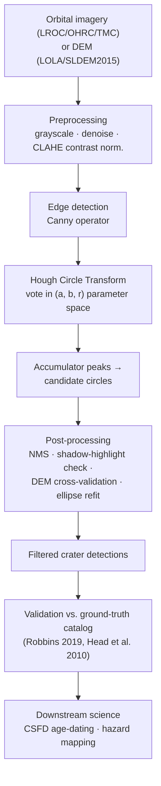

# Lunar Crater Detection Using the Hough Circle Transform
### A Comprehensive Technical Guide

---

## Table of Contents
1. [Why Automated Crater Detection Matters](#1-why-automated-crater-detection-matters)
2. [Crater Morphology Primer](#2-crater-morphology-primer-what-the-algorithm-is-actually-looking-for)
3. [Hough Circle Transform: Theoretical Foundations](#3-hough-circle-transform-theoretical-foundations)
4. [End-to-End Detection Pipeline](#4-end-to-end-pipeline-for-lunar-crater-detection)
5. [Worked Python Example](#5-worked-python-example)
6. [Where Classical HCT Breaks Down](#6-where-classical-hct-breaks-down-and-how-the-field-responds)
7. [Python Tools & Libraries](#7-python-tools--libraries)
8. [Datasets & Data Sources](#8-datasets--data-sources)
9. [Theoretical Knowledge Required](#9-theoretical-knowledge-required)
10. [Suggested Learning Path](#10-suggested-learning-path)
11. [Further Reading](#11-further-reading)

---

## 1. Why Automated Crater Detection Matters

Impact craters are the single most abundant landform on the Moon, and cataloging them is a core planetary-science task for three reasons:

- **Age-dating surfaces.** Crater Size-Frequency Distribution (CSFD) analysis is the primary tool for dating planetary surfaces where no rock samples exist: older terrain accumulates more craters over time, so crater density — calibrated against radiometrically-dated Apollo/Luna samples — yields relative and absolute ages via chronology/production functions.
- **Mission and landing-site safety.** Mission planners need hazard maps of rims, walls, and boulder fields for landers and rovers (this is exactly why ISRO's Chandrayaan-2 OHRC camera exists — it was purpose-built to image candidate landing sites at extreme resolution before descent).
- **Sheer scale.** The most complete modern catalog, Robbins (2019), lists **2,033,574 craters** on the Moon, of which **1,296,879 have diameters ≥1 km**, ~83,000 are ≥5 km, and 6,972 are ≥20 km. Manually tracing rims at this scale — and especially for smaller, degraded, or newly-imaged regions — is impractical, which is why automated Crater Detection Algorithms (CDAs) exist. Hough-transform-based methods are among the oldest and most widely used CDA families, dating back to lunar work like Sawabe, Matsunaga & Rokugawa (2005).

---

## 2. Crater Morphology Primer (what the algorithm is actually looking for)

Understanding *why* a Hough circle should exist in the image — and why it often doesn't — requires some basic photogeology:

- **Anatomy:** rim (raised crest) → wall/inner slope (often terraced in larger craters) → floor (flat, or with a central peak) → surrounding ejecta blanket (radial, sometimes with bright rays for young craters).
- **Simple vs. complex craters.** Below roughly 15–20 km diameter, lunar craters are simple bowl shapes. Above that transition diameter, wall slumping produces terraces, flat floors, and central peaks — so the "clean circular rim" a Hough transform wants is a different, messier shape at larger sizes.
- **Degradation.** Fresh craters have sharp rims and strong shadow contrast. Ancient, eroded, or regolith-buried craters have softened, broken rims — this progressively destroys the crisp edge signal that HCT depends on.
- **Illumination geometry.** Lunar images are usually taken at low sun angles (to maximize shadow relief), so a crater rim typically appears as a **bright crescent** (sun-facing slope) paired with a **dark crescent** (shadowed slope) rather than a uniform ring. Several classic lunar CDAs (e.g., the "shady/sunny" approach in Sawabe et al., or Urbach & Stepinski's 2009 work on Mars) detect this highlight–shadow *pair* directly, instead of, or in addition to, a plain edge-based circle fit.
- **Overlap and secondaries.** Clustered/overlapping craters and elongated secondary-crater chains (ejecta from a nearby larger impact) both violate the "one clean isolated circle" assumption HCT is built on.
- **Non-circularity.** Because impacts are more often oblique than vertical, many craters are measurably elliptical. A strict circular Hough transform fits these poorly — which is exactly why several recent papers use a *modified* or *elliptical* Hough transform for lunar work instead of the plain circular version.

---

## 3. Hough Circle Transform: Theoretical Foundations

### 3.1 The general idea
The Hough transform converts a shape-detection problem in **image space** into a peak-detection problem in **parameter space**. Instead of testing every possible circle against every pixel, each edge pixel "votes" for every parameter combination that could have generated it; a shape that's genuinely present accumulates a strong vote peak in a small region of parameter space.

### 3.2 Circle parameterization
A circle is defined by three parameters — center (a, b) and radius r:

```
(x − a)² + (y − b)² = r²
```

Three free parameters (versus two for a line) means the accumulator is a **3-D array (a, b, r)**. Brute-force voting across all three dimensions is expensive, which is the main practical reason nobody runs the textbook full-3D circle Hough transform on anything but tiny images.

### 3.3 The gradient-based method (what OpenCV actually runs)
What `cv2.HoughCircles` and most practical implementations use is a gradient-restricted variant: at each edge pixel, the local gradient direction estimates the direction toward the circle's center, so votes are cast along a line rather than the full circle of possibilities. This collapses the search to (nearly) 2-D for center-finding, then estimates the best-fitting radius per candidate center as a second pass — far cheaper than the brute-force 3-D version.

OpenCV exposes two `method` options:

| Method | Behavior |
|---|---|
| `cv2.HOUGH_GRADIENT` | Classic gradient-based method. `param1` sets the Canny **high** threshold (Canny's low threshold is fixed at half of it). `param2` is the accumulator vote threshold for accepting a center — lower values detect more circles, true *and* false. |
| `cv2.HOUGH_GRADIENT_ALT` | Added in **OpenCV 4.3**; generally more accurate for well-formed circles. Uses a Scharr-based gradient, so `param1` typically needs a much higher value (~300 is the commonly recommended starting point). `param2` becomes a **circle "perfectness"** score from 0–1 — values near 0.9 demand rounder, cleaner circles and reject noisy or partial rims. |

Other shared parameters: `dp` (inverse ratio of accumulator resolution to image resolution — `dp=1` keeps the accumulator at full image resolution), `minDist` (minimum allowed center-to-center distance, acting as the transform's own non-max suppression), and `minRadius`/`maxRadius` (hard cutoffs — for crater work, these should be set directly from your target crater-size range and the image's ground sample distance/pixel scale).

### 3.4 scikit-image's explicit accumulator
`skimage.transform.hough_circle(edge_image, radii)` computes one full accumulator per radius you supply, and `skimage.transform.hough_circle_peaks(...)` finds the strongest, best-separated peaks across all of them. It's more transparent (you can inspect the accumulator directly) and closer to how early lunar/Mars CDA papers describe their method, at some cost in speed versus OpenCV's compiled implementation. scikit-image also ships `hough_ellipse`, useful once you move beyond perfect circles to the oblique-impact case above.

---

## 4. End-to-End Pipeline for Lunar Crater Detection



**1. Data acquisition** — pick imagery/DEM whose native pixel scale matches your target crater-size range: WAC or SLDEM2015 for regional surveys of larger craters; NAC, TMC, or OHRC for small, fresh, or landing-site-scale craters (see §8 for exact numbers).

**2. Preprocessing** — grayscale conversion for optical images, or hillshade/slope derivation for DEMs; Gaussian or median blur to suppress the pixel-level noise HCT's voting is sensitive to; CLAHE/histogram equalization to normalize brightness across a mosaic stitched from many different illumination geometries.

**3. Edge detection** — Canny is the near-universal choice, because gradient-based HCT voting needs clean, thin, well-localized edges. Thresholds are tuned so rims survive while regolith texture and sensor noise are suppressed.

**4. Hough Circle Transform** — apply with `minRadius`/`maxRadius` computed from the image's ground sample distance (GSD) and your expected crater-diameter range (e.g., a 40–2000 m crater range at 5 m/pixel → roughly a 4–200 pixel radius search).

**5. Post-processing / false-positive suppression** — this is where lunar-specific engineering happens, beyond textbook HCT:
   - Non-maximum suppression on overlapping/duplicate hits.
   - **Shadow–highlight validation:** does a bright crescent + adjacent dark crescent really exist along the candidate rim, consistent with the image's known sun-incidence angle?
   - **DEM cross-validation:** does the candidate coincide with a real depression/rim in elevation or slope data, or is it just an optical-contrast ring caused by a boulder, secondary-crater fragment, or albedo feature?
   - **Elliptical refinement:** re-fit an ellipse (not just a circle) to rim points for obliquely-formed craters — the approach taken in recent LROC WAC-based work combining Canny edges, a modified Hough transform, and L1-norm/least-squares ellipse fitting.

**6. Validation** — match detections against an existing catalog (Robbins 2019 is the modern standard) using a distance-plus-diameter-ratio rule, then report precision, recall, F1, or IoU.

**7. Downstream science** — feed the validated list into CSFD age-dating, spatial-density mapping, or landing-hazard products.

---

## 5. Worked Python Example

### 5.1 Core OpenCV pipeline

```python
import cv2
import numpy as np
import matplotlib.pyplot as plt

# 1. Load a grayscale crop of lunar imagery (e.g., LROC WAC or Chandrayaan TMC)
img = cv2.imread("lunar_crop.png", cv2.IMREAD_GRAYSCALE)

# 2. Preprocess: denoise, then normalize contrast across uneven illumination
blurred = cv2.GaussianBlur(img, (5, 5), sigmaX=1.5)
clahe = cv2.createCLAHE(clipLimit=2.0, tileGridSize=(8, 8))
enhanced = clahe.apply(blurred)

# 3. Convert the real-world crater-size range you care about into a pixel
#    radius range, using the image's ground sample distance (GSD)
gsd_m_per_px = 5.0                       # e.g. Chandrayaan TMC ~5 m/pixel
min_crater_m, max_crater_m = 40, 2000
min_radius_px = int((min_crater_m / 2) / gsd_m_per_px)
max_radius_px = int((max_crater_m / 2) / gsd_m_per_px)

# 4. Hough Circle Transform (gradient method)
circles = cv2.HoughCircles(
    enhanced,
    cv2.HOUGH_GRADIENT_ALT,
    dp=1.5,
    minDist=min_radius_px * 1.5,         # suppress duplicate hits on one rim
    param1=300,                           # Scharr-based edge threshold (ALT method)
    param2=0.85,                          # circle "perfectness"; closer to 1 = stricter
    minRadius=min_radius_px,
    maxRadius=max_radius_px,
)

# 5. Draw and report results
output = cv2.cvtColor(img, cv2.COLOR_GRAY2BGR)
if circles is not None:
    circles = np.round(circles[0, :]).astype(int)
    for (cx, cy, r) in circles:
        cv2.circle(output, (cx, cy), r, (0, 255, 0), 2)
        cv2.circle(output, (cx, cy), 2, (0, 0, 255), 3)
    print(f"Detected {len(circles)} candidate craters")

plt.imshow(cv2.cvtColor(output, cv2.COLOR_BGR2RGB))
plt.axis("off")
plt.show()
```

### 5.2 scikit-image alternative (more transparent accumulator)

```python
import numpy as np
from skimage import io, color
from skimage.feature import canny
from skimage.transform import hough_circle, hough_circle_peaks

image = color.rgb2gray(io.imread("lunar_crop.png"))
edges = canny(image, sigma=2.5, low_threshold=10, high_threshold=40)

hough_radii = np.arange(min_radius_px, max_radius_px, 2)
hough_res = hough_circle(edges, hough_radii)

accums, cx, cy, radii = hough_circle_peaks(
    hough_res, hough_radii,
    min_xdistance=min_radius_px, min_ydistance=min_radius_px,
    total_num_peaks=200,
)
```

### 5.3 Validating detections against a ground-truth catalog

This mirrors the distance-plus-diameter-ratio matching rule used to build and cross-compare the major lunar crater catalogs (Robbins 2019 and predecessors):

```python
import numpy as np

def match_craters(detections, ground_truth, dist_frac=0.375, diam_frac=0.375):
    """
    Pair detected craters with a ground-truth catalog using the
    distance + diameter-ratio rule standard in the crater-detection literature:
        center distance <= dist_frac * average(D_detected, D_truth)
        |D_detected - D_truth| <= diam_frac * min(D_detected, D_truth)
    `detections` / `ground_truth` are DataFrames with x, y, diameter columns
    in the same coordinate and unit system.
    """
    matches, used_gt = [], set()
    for det_idx, det in detections.iterrows():
        for gt_idx, gt in ground_truth.iterrows():
            if gt_idx in used_gt:
                continue
            dist = np.hypot(det.x - gt.x, det.y - gt.y)
            avg_d = (det.diameter + gt.diameter) / 2
            if (dist <= dist_frac * avg_d and
                    abs(det.diameter - gt.diameter) <= diam_frac * min(det.diameter, gt.diameter)):
                matches.append((det_idx, gt_idx))
                used_gt.add(gt_idx)
                break

    precision = len(matches) / len(detections) if len(detections) else 0
    recall = len(matches) / len(ground_truth) if len(ground_truth) else 0
    return precision, recall, matches
```

---

## 6. Where Classical HCT Breaks Down, and How the Field Responds

Published results are candid about the limits of plain circular HCT:

- **Size range limits.** On Mars Global Surveyor DTM data, Athanassas et al. found the standard circular Hough transform reliably captured craters smaller than ~50 km but **failed to detect larger ones**, motivating a hybrid with the Determinant-of-Hessian operator to catch what CHT missed (though that operator, in turn, struggled on strongly undulating terrain).
- **Overlapping craters are slow and unreliable for HCT.** Work on the ERU-Net architecture found that using a Hough transform to detect rings within crater segmentation maps was less effective and slower than template matching once craters overlap heavily.
- **Sensitivity to parameter tuning.** Because `param1`/`param2`/`minRadius`/`maxRadius` all depend on image scale and contrast, a parameter set tuned for one mosaic tile often needs re-tuning for another — a recurring theme across the lunar/Mars CDA literature since Sawabe et al. (2005), whose improved algorithm's main claimed benefit was working *without* per-image parameter tuning.
- **False positives from non-crater circular features** — boulders, small hills, and compression artifacts can all masquerade as rims in a purely photometric, edge-based pass.

**How practice compensates:**
- **Hybrid classical pipelines:** boosting/classifier-based region proposal followed by local circular-Hough rim delineation, or Canny edges feeding a *modified* Hough transform restricted to validated edge points, followed by ellipse refinement (L1-norm fit, then least-squares) — an approach used in recent (2026) LROC WAC-based lunar work.
- **Deep-learning replacements and hybrids:** DeepMoon (Silburt et al., 2018) trains a U-Net CNN directly on DEM data and recovered 92% of craters in a human-labeled test set, nearly doubling total detections (with an estimated 11% false-positive rate on manually inspected new detections); YOLO-style object detectors (e.g., the LU5M812TGT catalog, built with "YOLOLens") now push completeness down to ~0.4 km craters globally.
- **HCT still earns its place** as a fast first-pass candidate generator, a lightweight option where on-board compute is limited, a teaching/prototyping tool for understanding the detection problem, and a component inside larger hybrid pipelines rather than a standalone, production-grade global detector.

---

## 7. Python Tools & Libraries

| Tool | Role in the pipeline | Install |
|---|---|---|
| **OpenCV** (`opencv-python`) | Core CV: `cv2.HoughCircles`, `cv2.Canny`, blurring, CLAHE, drawing/visualization | `pip install opencv-python` |
| **NumPy** | Array operations underlying essentially every step | `pip install numpy` |
| **scikit-image** | Alternative/complementary Hough implementation (`hough_circle`, `hough_circle_peaks`, `hough_ellipse`), plus `feature.canny` and other filters | `pip install scikit-image` |
| **Matplotlib** | Visualizing detections, accumulator arrays, overlays | `pip install matplotlib` |
| **SciPy** | `ndimage` filtering/morphology, `spatial` KD-trees for fast NMS/catalog matching | `pip install scipy` |
| **Pandas** | Handling crater catalogs and detection tables; precision/recall bookkeeping | `pip install pandas` |
| **rasterio** (or GDAL) | Reading georeferenced rasters (GeoTIFF, reprojected PDS DEMs), clipping, reprojecting | `pip install rasterio` |
| **`pdr`** (Planetary Data Reader) or **`planetaryimage`** | Reading NASA PDS-formatted `.IMG`/`.LBL` files (LROC, LOLA) directly, without manual format parsing | `pip install pdr` |
| **SpiceyPy** | Python wrapper for NASA's SPICE toolkit — spacecraft/Sun geometry, incidence angles; useful for the shadow-highlight validation step | `pip install spiceypy` |
| **scikit-learn** | Classical ML classifiers (SVM, random forest, boosting) for false-positive filtering in hybrid pipelines | `pip install scikit-learn` |
| **TensorFlow / PyTorch** | Deep-learning alternatives or hybrids (U-Net/DeepMoon-style segmentation, YOLO-style detectors) for comparison against HCT | `pip install tensorflow` / `pip install torch` |
| **Jupyter** | Interactive exploration and parameter tuning | `pip install jupyter` |

---

## 8. Datasets & Data Sources

### 8.1 Optical imagery

| Source | Instrument | Resolution | Swath | Notes |
|---|---|---|---|---|
| NASA LRO | LROC **NAC** (Narrow Angle Camera) | 0.5–2.0 m/pixel, panchromatic | ~5 km | Two cameras; best for small, fresh, or landing-site-scale craters |
| NASA LRO | LROC **WAC** (Wide Angle Camera) | 100 m/pixel (5 visible bands) / 400 m/pixel (2 UV bands) | ~60 km | Global multi-temporal mosaics; standard base map for regional/large-crater surveys |
| ISRO Chandrayaan-1 | **TMC** (Terrain Mapping Camera) | 5 m/pixel, panchromatic | ~20 km | Stereo (fore/nadir/aft), 10-bit |
| ISRO Chandrayaan-2 | **OHRC** (Orbiter High Resolution Camera) | 0.25 m/pixel at nadir (100 km altitude) | ~3 km | Highest-resolution lunar orbiter camera flown to date — surpasses LRO NAC's best 0.5 m; built for landing-site hazard imaging |
| ISRO Chandrayaan-2 | **TMC-2** | 5 m/pixel, stereo | — | Follow-on to Chandrayaan-1's TMC |
| JAXA SELENE/Kaguya | Terrain Camera (TC) | ~10 m/pixel–class stereo | — | Contributes to the SLDEM2015 merged DEM below |
| NASA Clementine (1994) | UVVIS | ~100–200 m/pixel-class | Global | Historic mission; useful for long-baseline change/comparison studies |

### 8.2 Elevation / topography

| Product | Coverage | Resolution | Notes |
|---|---|---|---|
| **LOLA** (raw altimetry) | Near-global | Point/profile data; >6.5 billion measurements | ~10 cm vertical precision, ~1 m accuracy; needs gridding before use as a raster |
| **SLDEM2015** | ±60° latitude | 512 px/degree (~59 m/pixel at equator); 128/256 px/degree products also available | LOLA + Kaguya TC co-registered merge; ~3–4 m vertical accuracy; PDS IMG and JPEG-2000 formats |
| **GLD100** | Near-global | ~100 m/pixel | LROC WAC stereo photogrammetric DTM |

### 8.3 Ground-truth crater catalogs (for training/validation)

| Catalog | Size range | Approx. count | Notes |
|---|---|---|---|
| **Robbins (2019)** | Complete for D ≥ 1–2 km | ~2.03M total craters; 1.30M ≥1 km; ~83,000 ≥5 km; 6,972 ≥20 km | Manually traced on WAC/TC/hillshade DTMs; the current standard reference catalog; matching rule (distance ≤ 0.375·avg(D₁,D₂), diameter ratio ≤ 0.375·min(D₁,D₂)) is the field's de facto validation standard |
| **Head et al. (2010)** | ≥20 km | — | LOLA-based |
| **Povilaitis et al. (2018)** | ≥5 km | — | Extends Head et al. to smaller craters |
| **Salamunićcar et al. (2012)** | Various | — | Built with an automated CDA using Canny and Shen–Castan edge detection |
| **LU5M812TGT (2024)** | ≥0.4 km | — | AI-derived (YOLOLens object detector), global coverage |

### 8.4 Where to get the data
- **NASA Planetary Data System (PDS)** — Cartography and Imaging Sciences Node / Geosciences Node: raw LROC, LOLA, SLDEM2015 archives.
- **USGS Astrogeology "Astropedia"** — pre-processed mosaics, DEMs, and the Robbins crater database, often as ready-to-use GeoTIFFs/shapefiles.
- **LROC website (ASU)** — NAC/WAC search and download tools.
- **ISSDC Chandrayaan Data Explorer (ISRO)** — TMC, TMC-2, and OHRC data products.

---

## 9. Theoretical Knowledge Required

### A. Digital image processing fundamentals
- Convolution and filtering (kernels, Gaussian/median blur)
- Gradient operators (Sobel, Scharr) and how they estimate edge direction and magnitude
- The Canny edge-detection pipeline: noise suppression → gradient computation → non-maximum suppression → double thresholding → edge-tracking by hysteresis
- Thresholding and binarization
- Morphological operations (erosion, dilation, opening, closing) for cleaning binary edge/mask images
- Histogram equalization / CLAHE for contrast normalization across unevenly illuminated mosaics

### B. Hough transform mathematics
- The image-space ↔ parameter-space duality and voting/accumulator concept
- Why circle detection is a 3-parameter (a, b, r) problem versus a line's 2 parameters
- Gradient-direction-restricted voting (how the practical, OpenCV-style method reduces cost from the brute-force version)
- Peak-finding and non-maximum suppression within accumulator space
- Elliptical/generalized Hough transform basics, for oblique-impact (non-circular) craters

### C. Planetary science and remote sensing
- Impact crater morphology and morphometry (rim, wall, floor, ejecta blanket, central peak, terracing)
- The simple-to-complex transition diameter and what controls it
- Crater degradation classification, and how age/erosion changes rim sharpness and detectability
- Illumination geometry — incidence angle, local solar time, and the resulting shadow–highlight signature exploited by many CDAs
- Crater Size-Frequency Distribution (CSFD) analysis and production/chronology functions used for age-dating
- Secondary craters, and how they can contaminate a "primary impact crater" catalog
- Ground sample distance (GSD)/pixel scale, and how it bounds the smallest detectable crater size
- Map projections used for planetary raster data (simple cylindrical, orthographic, polar stereographic) and why careful reprojection matters near the poles

### D. Evaluation methodology (and optional machine learning)
- Precision, recall, F1-score, and Intersection-over-Union (IoU) for comparing detections against a catalog
- Distance-plus-diameter-ratio matching rules for pairing detections with ground-truth craters
- Basic classifier concepts (SVM, boosting, random forest) if adding a false-positive-filtering stage on top of HCT
- CNN/U-Net/YOLO fundamentals, useful for benchmarking HCT against — or hybridizing it with — modern deep-learning crater detectors

### E. Programming and data-handling basics
- NumPy array manipulation and vectorized operations
- Reading georeferenced raster data and understanding coordinate reference systems
- Working with the PDS3/PDS4 archive formats that lunar mission data is typically distributed in

---

## 10. Suggested Learning Path

1. **Python foundations** — comfort with NumPy array manipulation and Matplotlib plotting.
2. **Classical image processing** — implement thresholding and a basic edge detector by hand once, for intuition, then switch to `cv2.Canny` for real work.
3. **Hough transform theory** — implement a simple Hough *line* transform from scratch first (2 parameters, easier to visualize) before tackling circles, to build intuition for the voting/accumulator idea.
4. **Library APIs on easy images** — run `cv2.HoughCircles` and `skimage.transform.hough_circle`/`hough_circle_peaks` on synthetic or simple photos (coins, dots) before touching real lunar data.
5. **Planetary-science background** — a short lunar photogeology primer covering crater morphology, illumination geometry, and CSFD, read alongside the algorithm work in step 3–4.
6. **Real data, small scale** — download a small crop of LROC WAC or Chandrayaan TMC imagery plus a matching SLDEM2015 tile, and run the full pipeline (§4) end-to-end on one region.
7. **Validation** — compare your detections against the Robbins (2019) catalog for that same region and compute precision/recall.
8. **(Optional, advanced)** — compare against, or hybridize with, a boosting classifier or a small CNN (DeepMoon-style U-Net) to see concretely where pure HCT falls short.

---

## 11. Further Reading

- Robbins, S. J. (2019). *A New Global Database of Lunar Impact Craters >1–2 km.* Journal of Geophysical Research: Planets. — the modern standard ground-truth catalog and its construction/matching methodology.
- Head, J. W. et al. (2010) and Povilaitis, R. Z. et al. (2018) — earlier large-crater (≥20 km, then ≥5 km) catalogs built on LOLA data.
- Sawabe, Y., Matsunaga, T., & Rokugawa, S. (2005). *Automatic crater detection algorithm for the lunar surface using multiple approaches.* J. Remote Sens. Soc. Japan. — an early, influential lunar CDA combining shadow/highlight detection with a fuzzy Hough transform.
- Salamunićcar, G. & Lončarić, S. — automated CDA work using Canny and Shen–Castan edge detection ahead of Hough-family circle fitting.
- Urbach, E. R. & Stepinski, T. F. (2009) — highlight/shadow crescent-pairing crater detection, demonstrated on sub-kilometer Martian craters.
- Athanassas, C. D., Vaiopoulos, A., Kolokoussis, P., & Argialas, D. — combining the circular Hough transform with the Determinant of Hessian on Mars DTM data, a good case study in HCT's size-range limitations.
- Silburt, A. et al. (2018). *Lunar Crater Identification via Deep Learning* (the open-source **DeepMoon** project) — a CNN/U-Net benchmark that's useful to compare classical HCT results against.
- A 2026 lunar crater detection paper in *Aerospace* (MDPI) combining ROI selection, Canny edges, a modified Hough transform, and ellipse refinement on LROC WAC imagery — a good template for a modern, non-circular Hough-based pipeline.
- Official documentation: `docs.opencv.org` (Hough Circle Transform tutorial) and `scikit-image.org` (Circular and Elliptical Hough Transforms example) for the exact, current function signatures.

---

*This guide reflects published mission specifications and library APIs as of mid-2026; always check `docs.opencv.org` and `scikit-image.org` directly for the latest parameter defaults before building a production pipeline.*
